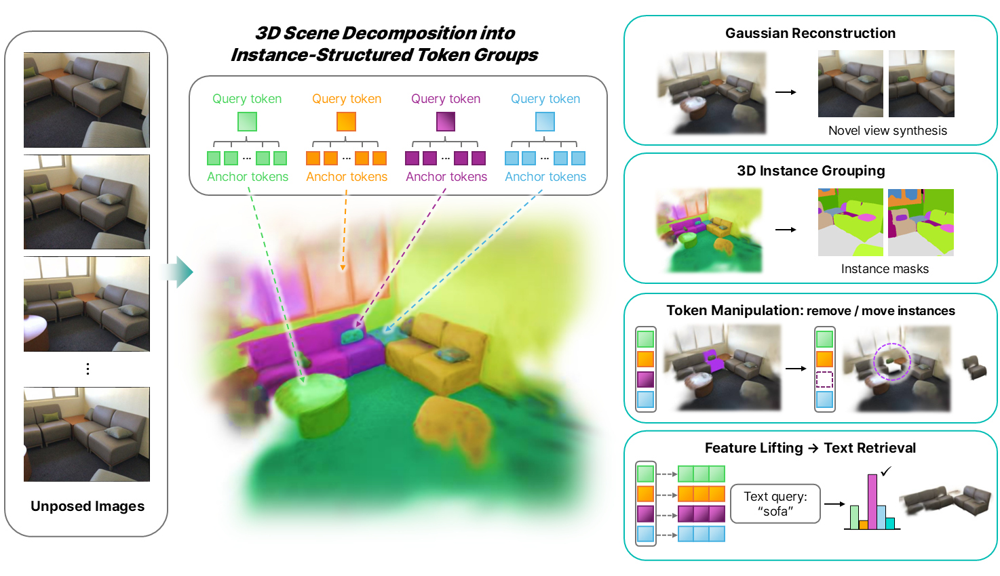

# InsTok3D — Scenes as Objects, Not Primitives

**Instance-Structured 3D Tokenization from Unposed Views** (NeurIPS 2026)

Mijin Yoo\*, In Cho\*, Subin Jeon, Jiwoo Lee, Eunbyung Park, Seon Joo Kim
&nbsp;·&nbsp; Yonsei University, Seoul National University &nbsp;·&nbsp; \*equal contribution

[Paper](https://arxiv.org/abs/2606.29513) &nbsp;|&nbsp; [Project page](https://yoomimi.github.io/instok3d) &nbsp;|&nbsp; [Models](https://huggingface.co/mynameisyoomimi/instok3d)



InsTok3D is a feed-forward model that turns unposed multi-view images into
*instance-structured 3D token groups*. Each group pairs one instance token with the anchor
tokens it owns, and every anchor token decodes into a set of 3D Gaussians. Reconstruction,
class-agnostic 3D instance grouping and open-vocabulary feature lifting all operate on the
same token groups, and training needs only 2D supervision (RGB images and 2D instance masks).

This repository contains the training and evaluation code and the pretrained models of
the paper.

## Installation

Tested with Python 3.10, PyTorch 2.7.1 and CUDA 12.6.

```bash
git clone https://github.com/yoomimi/instok3d.git && cd instok3d
conda create -n instok3d python=3.10 -y && conda activate instok3d
bash setup.sh
```

`setup.sh` installs PyTorch, builds the two CUDA extensions (`external/pointops` and
[gsplat](https://github.com/nerfstudio-project/gsplat)) and installs `requirements.txt`.
It needs `nvcc` on the `PATH`.

## Pretrained models

```bash
huggingface-cli download mynameisyoomimi/instok3d --local-dir pretrained
```

| Model | Views | Training data | Used for |
|---|---|---|---|
| `instok3d_scannet_2view` | 2 | ScanNet | Table 1 (reconstruction), Table 3 |
| `instok3d_scannet_2view_lseg` | 2 | ScanNet, ScanNet++ | Table 1 (feature lifting), Table 4 |
| `backbones/vggt_intr_scannet_2view.safetensors` | 2 | ScanNet, ScanNet++ | fine-tuned VGGT backbone of both models |

```
pretrained/
├── backbones/vggt_intr_scannet_2view.safetensors
├── instok3d_scannet_2view/{config.yaml, model.safetensors}
└── instok3d_scannet_2view_lseg/{config.yaml, model.safetensors}
```

A model directory holds the weights of the tokenizer and its config. The frozen backbone
is stored separately in `pretrained/backbones/` and the feature-lifting model loads its
frozen tokenizer from `pretrained/instok3d_scannet_2view`; both paths are part of the
config. The backbone is fine-tuned from [VGGT-1B](https://huggingface.co/facebook/VGGT-1B),
so all weights are for non-commercial use (see [License](#license)).

The 8-view ScanNet, RealEstate10K and Stage-1 models of the paper are not released; they
can be trained with the configs of this repository (see [Training](#training)).

## Data

See [docs/DATA.md](docs/DATA.md) for the layout of ScanNet, the 40-scene ScanNet test
split, ScanNet++, RealEstate10K (with SAM2 pseudo-labels) and Mip-NeRF 360.

## Evaluation

```bash
# Table 1 (reconstruction) and Table 3: ScanNet, 2 context views
python evaluate.py eval_scannet_2view e.load=pretrained/instok3d_scannet_2view

# Table 1 (feature lifting) and Table 4: needs the LSeg checkpoint, see "Feature lifting"
python evaluate.py eval_feature_lifting e.load=pretrained/instok3d_scannet_2view_lseg
```

Metrics (`metrics_report.json`) and qualitative results are written to
`<e.load>/outputs/`. `e.load` also accepts a training run (`logs/<run>`); the best-score
checkpoint is used unless `is_best=false`. Evaluation runs on one GPU.

Results of this code with the released models (256 x 256 inputs):

| Setting | Metrics | This code | Paper |
|---|---|---|---|
| ScanNet 2 views (Table 1) | PSNR / SSIM / LPIPS | 25.28 / 0.771 / 0.238 | 25.28 / 0.771 / 0.238 |
| ScanNet 2 views (Table 1) | source mIoU / Acc | 0.660 / 0.786 | 0.661 / 0.786 |
| ScanNet 2 views (Table 1) | target mIoU / Acc | 0.657 / 0.788 | 0.657 / 0.789 |
| ScanNet 2 views (Table 3, ours) | PSNR / SSIM / LPIPS | 25.11 / 0.769 / 0.240 | 25.11 / 0.769 / 0.240 |
| ScanNet 2 views (Table 3, ours) | AP / AP50 / AP25 | 0.193 / 0.377 / 0.529 | 0.193 / 0.377 / 0.529 |

The other benchmarks of the paper are evaluated the same way with a model you trained:

```bash
python evaluate.py eval_scannet_8view e.load=logs/<run>    # Table 2: ScanNet, 8 context views
python evaluate.py eval_re10k e.load=logs/<run>            # Table 5: RealEstate10K
python evaluate.py eval_mipnerf360 e.load=logs/<run>       # Table 6: zero-shot Mip-NeRF 360, Stage-1 model
```

The predicted Gaussians and token groups of test samples can be exported as standard 3D
Gaussian Splatting `.ply` files (`scene.ply`, one `group_<id>.ply` per instance group):

```bash
python evaluate.py export_gaussians e.load=pretrained/instok3d_scannet_2view data_indices=0,8
```

Evaluation protocol:

- Reconstruction and instance metrics use 100 steps of test-time pose alignment of the
  target cameras (`eval.pose_align_steps`), following prior work; it is a short
  optimisation, so results vary in the last digit between runs. Feature-lifting metrics
  use the given cameras.
- `eval_scannet_2view` evaluates the first triplet of each of the 40 test scenes
  (`data_indices`); pass `data_indices=null` for all 320 triplets. The feature-lifting
  evaluation uses all 320 triplets.
- The ScanNet test frames are pre-processed with a principal-point square crop
  (`crop_mode: pp_square`) in `eval_scannet_2view` / `eval_scannet_8view`. Table 3 and the
  feature-lifting evaluation use the DUSt3R-style crop of LSM / Uni3R instead: add
  `dm.dataset.crop_mode=dust3r` to `eval_scannet_2view` to reproduce the Table 3 row.
- AP is the class-agnostic mask AP on the target views (COCO-style, IoU 0.50:0.95); groups
  are ranked by the fraction of anchors assigned to them.
- `eval_scannet_*` / `eval_re10k` average PSNR and SSIM per view and feed LPIPS (VGG) with
  images in [-1, 1]. `eval_mipnerf360` follows the protocol of the baseline it is compared
  with: PSNR / SSIM per sample and LPIPS (VGG) on images in [0, 1].
- `eval_re10k` covers the 5,601 test sequences of the pixelSplat / MVSplat evaluation index
  for which SAM2 pseudo-labels exist (`datasets/re10k/masks_test`). Without the labels,
  add `dm.data_sources.0.instance_mask_dir_fmt=null dm.dataset.use_instance_mask=false` to
  evaluate reconstruction on all indexed sequences.
- A Stage-1 model has no grouping head: evaluate it with `eval=benchmark_recon`, e.g.
  `python evaluate.py eval_scannet_2view eval=benchmark_recon e.load=logs/recon_scannet_2view`.

## Training

Training has three steps; each one starts from the output of the previous one, and the
backbone is frozen after step 0. `e.name=<run>` names the run and writes it to
`logs/<run>/` (`config.yaml`, `checkpoints/`).

| | ScanNet 2 views | ScanNet 8 views | RealEstate10K |
|---|---|---|---|
| 0. Backbone fine-tuning | `train_backbone_scannet_2view` | `train_backbone_scannet_8view` | `train_backbone_re10k` |
| 1. Reconstruction (anchor tokens) | `train_recon_scannet_2view` | `train_recon_scannet_8view` | `train_recon_re10k` |
| 2. Joint reconstruction + grouping | `train_tokenizer_scannet_2view` | `train_tokenizer_scannet_8view` | `train_tokenizer_re10k` |

```bash
# 0. Fine-tune VGGT (16-px patches for 256 x 256 inputs, intrinsics token) with an auxiliary
#    pixel-aligned Gaussian head, then extract the backbone weights.
python train.py train_backbone_scannet_2view e.name=backbone_scannet_2view
python run_script.py scripts/extract_backbone_weights.py run=logs/backbone_scannet_2view \
    output=pretrained/backbones/my_vggt_intr.safetensors

# 1. Stage 1: anchor tokens with the rendering loss only.
python train.py train_recon_scannet_2view e.name=recon_scannet_2view \
    backbone.finetuned_weights_path=pretrained/backbones/my_vggt_intr.safetensors

# 2. Stage 2: add the group tokens and train reconstruction and grouping jointly.
python train.py train_tokenizer_scannet_2view e.name=tokenizer_scannet_2view \
    init_from=logs/recon_scannet_2view \
    backbone.finetuned_weights_path=pretrained/backbones/my_vggt_intr.safetensors

# Optional: export a run as a model directory (config.yaml + model.safetensors).
python run_script.py scripts/export_model.py run=logs/tokenizer_scannet_2view \
    output=pretrained/my_instok3d_scannet_2view
```

Without `backbone.finetuned_weights_path`, steps 1 and 2 read the backbone from
`pretrained/backbones/vggt_intr_<setting>.safetensors`. For ScanNet 2 views this is the
released backbone, so step 0 can be skipped; for the other two settings run step 0 and
extract the backbone to that path.

The configs carry the hyper-parameters of the paper: K = 1024 anchor tokens, N_g = 32
Gaussians per anchor, L = 100 group tokens, 6 / 4 decoder layers, AdamW with a cosine
learning-rate decay, gradient clipping 0.5, `bf16-mixed` precision, λ_lpips = 0.05 and a
linear warm-up of λ_seg over the first 10 epochs. The paper runs used 4 GPUs with the
per-GPU batch size of the configs; keep `number of GPUs x dm.batch_size` constant when
changing either. In step 0 the backbone is trained with 0.1 x the listed learning rate.
Validation during training, and with it the selection of the best checkpoint, runs on the
test split of the setting.

| | ScanNet 2 views | ScanNet 8 views | RealEstate10K |
|---|---|---|---|
| Step 0: epochs / batch per GPU / lr | 20 / 32 / 2e-4 | 20 / 16 / 2e-4 | 100 / 32 / 2e-4 |
| Step 1: epochs / batch per GPU / lr | 40 / 8 / 5e-5 | 60 / 16 / 1e-4 | 50 / 8 / 1e-4 |
| Step 1: anchors K / offset bound | 512 / 0.1 | 1024 / 0.5 | 512 / 0.1 |
| Step 2: epochs / batch per GPU / lr | 200 / 16 / 1e-4 | 200 / 16 / 1e-4 | 200 / 32 / 2e-4 |
| Step 2: λ_seg / offset bound | 0.1 / 0.1 | 0.5 / 1.0 | 0.1 / 0.1 |
| Step 2: checkpoint selection | PSNR | AP50, then PSNR | PSNR |

Useful options (see [docs/CONFIG.md](docs/CONFIG.md)): `e.gpus=N` (number of GPUs),
`dm.batch_size=N` (per GPU), `resume=true|best|last|null`, `e.debug=true` (one training
and one validation batch, no logging). Metrics are logged to Weights & Biases if
`secrets/wandb.yaml` exists, and to `logs/<run>/csv_logs/` otherwise. The first run
downloads VGGT-1B (backbone fine-tuning only) and the VGG weights of LPIPS.

Ablations of Table 3: `solver.seg_loss_warmup_epochs=0` trains without the λ_seg warm-up,
and `model.freeze_non_instance_modules=true` trains the grouping head on a frozen Stage-1
model (sequential training).

### Feature lifting

Feature lifting distils [LSeg](https://github.com/isl-org/lang-seg) features into a 512-d
group-level embedding plus 8-d anchor-level residuals on top of a frozen tokenizer.
Download the LSeg checkpoint `demo_e200.ckpt` from the lang-seg repository to
`pretrained/lseg/demo_e200.ckpt`, then

```bash
python train.py train_feature_lifting e.name=feature_lifting_scannet_2view \
    model.recon_model_path=pretrained/instok3d_scannet_2view
python evaluate.py eval_feature_lifting e.load=logs/feature_lifting_scannet_2view
```

`model.feature_mode=all|group|anchor` selects the variants of Table 4.

## Repository layout

```
train.py, evaluate.py, run_script.py   entry points
config/                                 entry configs and sub-configs (docs/CONFIG.md)
instok3d/
├── backbones/      VGGT with 16-px patches and an intrinsics token
├── models/         tokenizer (anchor / group tokens), pixel-aligned head, feature lifting
├── solvers/        training and validation loops
├── losses/         rendering loss, Hungarian-matched grouping loss, feature distillation
├── data/           multi-dataset loader, view samplers, test sets
├── evaluators/     benchmark evaluators
└── metrics/, modules/, teachers/, utils/, vis/
engine/                                 config and dependency-injection layer over Lightning
external/                               vendored third-party code (VGGT, LSeg, pointops)
scripts/                                backbone extraction, model export
```

## Citation

```bibtex
@inproceedings{yoo2026instok3d,
  title     = {Scenes as Objects, Not Primitives: Instance-Structured 3D Tokenization from Unposed Views},
  author    = {Yoo, Mijin and Cho, In and Jeon, Subin and Lee, Jiwoo and Park, Eunbyung and Kim, Seon Joo},
  booktitle = {Advances in Neural Information Processing Systems (NeurIPS)},
  year      = {2026}
}
```

## Acknowledgements

This code builds on [VGGT](https://github.com/facebookresearch/vggt),
[Uni3R](https://github.com/HorizonRobotics/Uni3R), [C3G](https://github.com/cvlab-kaist/C3G),
[LSM](https://github.com/NVlabs/LSM), [LSeg](https://github.com/isl-org/lang-seg),
[gsplat](https://github.com/nerfstudio-project/gsplat) and [DUSt3R](https://github.com/naver/dust3r).
We thank the authors for releasing their work.

## License

The code is released under [CC BY-NC 4.0](LICENSE) for non-commercial use. Third-party
components keep their own licenses, see [THIRD_PARTY_NOTICES.md](THIRD_PARTY_NOTICES.md).
The pretrained weights are derived from VGGT-1B and are additionally subject to the VGGT
license.
